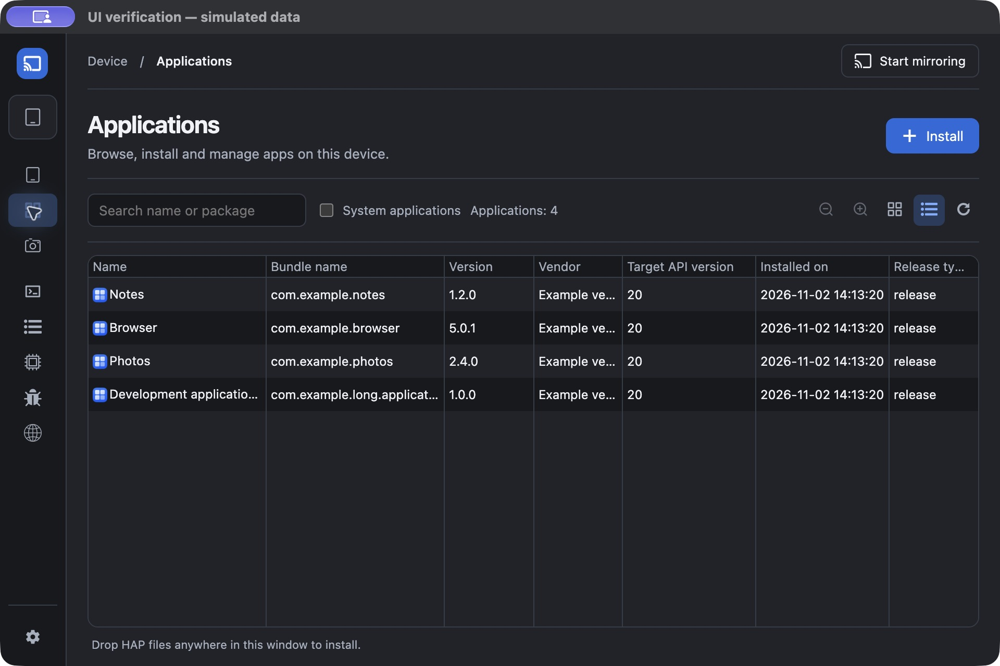

# Scrcpy Plus

当前 Plus 构建支持 Windows x64 和 macOS Apple Silicon（arm64）。不再支持 Intel Mac；已有 Intel 安装包仅作为历史发行附件保留。

Scrcpy Plus 作为本项目的正式延续，仓库已迁移至 `MonsterXia/scrcpy-plus`，检查更新与问题反馈使用新地址。已有 Harmony 用户请手动安装 Plus，不提供自动配置迁移；已有 Plus 的配置与应用标识保持不变。保留全部发行历史，下方继承的鸿蒙文档描述历史版本。详见[迁移记录](docs/maintenance/scrcpy-plus-rename.md)。

基于 Scrcpy Harmony 改造的安卓、鸿蒙与 iOS 投屏工作台。当前开发版的配置、能力边界与验证状态见[集成说明](docs/scrcpy-plus/integration.md)。安卓 USB/ADB 与 iOS AirPlay 已改为源码库集成，并在应用内显示；开发构建条件与未验收范围见集成说明。以下内容为继承的鸿蒙项目文档与历史发行信息。

开发分支提供 iOS USB WDA 截图/控制，默认启用 ReplayKit 连续视频；iPhone 13 的视频、输入及重连基本验证通过，长稳与跨平台验收仍待完成，见 [iOS USB 配置](docs/scrcpy-plus/ios-usb-wda.md)。

1.0.5-dev.3 开发预发布新增应用内 Apple ID 登录、WDA 自动准备，以及应用运行且手机连接时的自动续签。macOS 应用内登录、签名安装、启动及受控时钟触发的真实续签已验证；干净环境、实际七天到期及 Windows 仍待验收，见 [实现状态](docs/maintenance/ios-desktop-provisioning.md)。

开发版自动化已提供共享本地服务、独立 Node CLI 与 [MCP stdio](docs/scrcpy-plus/automation/mcp.md)，支持会话、截图、输入和现有 Harmony 工具。参见[使用指南](docs/scrcpy-plus/automation/README.md)与 [Agent skill](.agents/skills/scrcpy-plus-automation/SKILL.md)。本机模拟流程通过，真机自动化及 Windows 自动化端到端验收仍待完成。

## 1.0.5-dev.3 开发预发布

**[Scrcpy Plus 1.0.5-dev.3 已公开](https://github.com/MonsterXia/scrcpy-plus/releases/tag/v1.0.5-dev.3)**：包含应用内 iPhone 准备与 WDA 续签、iOS 重连修复、Plus 自适应图标、公共弹窗及迁移后的 Plus 更新源。Mac arm64 发行包已通过 Developer ID 签名、Apple 公证及 Gatekeeper 校验，Windows x64 仍未签名。当前验证与设备限制见[发行记录](docs/releases/1.0.5-dev.3.md)。稳定 Latest 保持 1.0.4。

## 历史 1.0.5-dev.2 开发预发布

**[Scrcpy Plus 1.0.5-dev.2 已公开](https://github.com/MonsterXia/scrcpy-plus/releases/tag/v1.0.5-dev.2)。** 源码、附件校验和验收范围见[发行记录](docs/releases/1.0.5-dev.2.md)。稳定 Latest 保持 **Scrcpy Harmony 1.0.4**。

本版本包含安卓/鸿蒙投屏、iOS AirPlay、USB iPhone 概览、统一设备工作区、即时语言切换，以及独立 Node CLI/MCP 客户端。USB WDA 截图/控制和 ReplayKit 视频为实验能力，需另行签名运行 Runner；真机控制/视频验收仍待完成。

**从 Harmony 切换到 Plus：** 两者安装和配置身份不同。保留原 Harmony 安装与设置；Plus 创建自己的配置目录（macOS 为 `~/Library/Application Support/Scrcpy Plus`，Windows 为 `%APPDATA%\Scrcpy Plus`），不会自动迁移 Harmony 设置。已有 Plus 开发版继续使用原 Plus 配置。更新器仅打开发行页供手动安装，不自动安装更新。

按电脑选择 Windows x64 EXE 或 macOS arm64 DMG。可选 `scrcpy-plus-cli-1.0.5-dev.2.tgz` 包含 CLI 和 MCP，需要 Node >=22.12 及正在运行的桌面应用。签名和验收结果按版本记录；桌面安装包不分发 WDA 签名产物。

---

## Scrcpy Harmony 历史版本

[](https://github.com/MonsterXia/scrcpy-plus/releases)
[](https://github.com/MonsterXia/scrcpy-plus/releases)
[](https://github.com/MonsterXia/scrcpy-plus/releases/latest)

[English](README.md) | **中文**

Scrcpy Harmony 是面向鸿蒙设备的 HDC 图形化桌面工具，集成投屏控制、应用管理、日志查看和调试功能。

[下载应用](https://github.com/MonsterXia/scrcpy-plus/releases/latest) · [更新日志](CHANGELOG.md) · [问题反馈](https://github.com/MonsterXia/scrcpy-plus/issues)


**1.0.5-dev.1 开发预发布：** 修复应用图标查询与 UITest 代理兼容性，保护外部工具的活动会话。1.0.5 系列已实现确认的轻量桌面工作台设计，见[新版使用指南](docs/user-guide-1.0.5.md)、[分阶段路线](docs/superpowers/plans/2026-11-03-v1.0.5-ui-roadmap.md)与[验收记录](docs/maintenance/v1.0.5-ui-completion.md)。投屏和升级窗口保留现有设计；已公开 [dev.1](https://github.com/MonsterXia/scrcpy-plus/releases/tag/v1.0.5-dev.1)，见[验证记录](docs/releases/1.0.5-dev.1.md)；稳定 Latest 仍为 1.0.4。



### 功能

| 功能 | 说明 |
| --- | --- |
| 投屏与控制 | 查看设备画面，使用鼠标点击、拖动，输入文本、操作系统按键 |
| 设备概览 | 查看设备型号、系统版本和屏幕信息 |
| 截屏 | 捕获、查看并保存设备截图 |
| 应用管理 | 安装、卸载应用，查看应用信息，清理缓存或数据 |
| 进程与日志 | 查看进程、浏览和筛选 HiLog 日志、导出日志文件 |
| 调试工具 | 交互终端、布局查看、端口转发与 WebView 调试 |

### 下载安装

前往 [Scrcpy Harmony 1.0.4](https://github.com/MonsterXia/scrcpy-plus/releases/tag/v1.0.4)，按电脑系统和处理器选择安装包：

| 平台 | 安装包后缀 | 安装方式 |
| --- | --- | --- |
| Windows x64 | `win-x64.exe` | 运行安装程序，按提示完成安装 |
| macOS Apple Silicon | `mac-arm64.dmg` | 打开镜像，将应用拖入“应用程序”目录 |
| macOS Intel | `mac-x64.dmg` | 打开镜像，将应用拖入“应用程序”目录 |

macOS 需要 **13 或更新版本**。当前未提供 Linux 安装包。

安装包已包含 HDC 和所需设备资源，日常使用无需安装 Node.js。详细安装与连接步骤见[用户指南](docs/user-guide.md)。

**Windows 安装包未做发行者签名；macOS 使用 ad-hoc 签名，无 Developer ID 或公证。** 系统仍可能提示安装限制，请核对下载来源和校验值；公开状态与实际验证结果见 [1.0.4 发布记录](docs/releases/1.0.4.md)。

**[1.0.4 已作为正式 Latest 发布](https://github.com/MonsterXia/scrcpy-plus/releases/tag/v1.0.4)。** 三平台安装与直接升级/更新检查通过；签名限制和未补测真机范围继续在发布记录中明确列出。

以下为历史 Harmony **1.0.5-dev.1** 开发预发布说明，保留 1.0.4 的功能，包括 H.264 投屏与 JPEG 回退、键盘/IME 和文本粘贴、HAP 拖入安装、空闲投屏残留的受限恢复、商店请求有限等待、中英文选择，以及清楚显示开启/关闭、文字对齐的 **Beta Update／接收预发布更新** 菜单。升级可选择[稳定版 1.0.4](https://github.com/MonsterXia/scrcpy-plus/releases/tag/v1.0.4)或[开发版 1.0.5-dev.1](https://github.com/MonsterXia/scrcpy-plus/releases/tag/v1.0.5-dev.1)；应用配置目录保持不变。Beta Update 位于应用菜单，默认关闭，发现开发预发布需开启；[发行证据与限制](docs/releases/1.0.5-dev.1.md)另行记录。

**1.0.3** 保留为依赖源码迁移前的恢复版本。从 ECHO 切换时需要重新配置设置，其独立配置目录不会自动迁移。设备兼容和待验收范围见发布记录；反馈问题时请附版本和提交号。

### 快速上手

1.0.4会向兼容手机自动部署内置原生采集库，使用 H.264 投屏，无需手机预装该库，也不需要 Java。设备不兼容时回退 JPEG。

1.0.4支持 JPEG 回退后，在画面再次变化时自动尝试一次恢复视频；也可在投屏工具栏点击“切换到视频”。尝试期间保持 JPEG，视频首帧真正显示后再交接，失败时继续使用 JPEG。

1. 在鸿蒙设备上开启开发者选项和 USB 调试，通过 USB 数据线连接电脑，并在设备端允许调试连接。具体设置入口以设备系统版本为准。
2. 启动 Scrcpy Harmony，在顶部设备列表中选择设备；未出现时点击旁边的“刷新”。
3. 点击“投屏”打开设备画面，使用鼠标点击、拖动；选中手机输入框后可直接通过键盘输入或粘贴。
4. 在主窗口切换“应用”“终端”“日志”等面板使用对应工具。导出 HiLog 时，点击“日志”面板工具栏的“保存”。

应用默认使用内置 HDC。需要使用其他版本时，可在设置中的“HDC 位置”指定可执行文件路径。

1.0.4已补齐简体中文和英文界面。在“设置 → 语言”选择“系统设置”“English”或“简体中文”，再重启应用，将语言应用到所有窗口和菜单。中文和英文的系统地区变体分别使用简体中文和英文，其他系统语言默认使用英文。开发界面时请遵循[国际化流程](.agents/skills/scrcpy-plus-project/references/internationalization.md)，并运行 `npm run check:i18n`。

#### 常见问题

- **设备列表为空**：确认数据线支持数据传输、设备已允许调试连接，再刷新列表。使用自定义 HDC 时，检查“HDC 位置”是否有效。
- **能看到设备，但无法投屏或查看布局**：这些功能还依赖设备系统与 uitestkit 的兼容性。反馈时请附上设备型号、系统版本和具体错误信息。
- **检查更新后如何升级**：应用会提示打开本仓库的 Releases 页面，需要手动下载并安装新版本。

更多问题可通过 [Issues](https://github.com/MonsterXia/scrcpy-plus/issues) 或应用菜单“帮助 → 报告问题”反馈。请提供应用版本、电脑系统、设备型号、HarmonyOS/HDC 版本、复现步骤及预期与实际结果；上传日志或截图前请移除设备标识和个人信息。

## 仓库结构

| 路径 | 维护内容 |
| --- | --- |
| `src/main/`、`src/preload/` | Electron 主进程、设备操作与 IPC 桥接 |
| `src/renderer/`、`src/common/` | React 窗口、应用类型、国际化和主题 |
| `src/share/`、`src/renderer/icon/` | 共享 Electron 代码与图标源，均为普通跟踪目录 |
| `vendor/packages/hdckit/src/` | HDC 客户端原始 TypeScript |
| `vendor/packages/licia/src/`、`vendor/packages/licia/test/` | Licia 原始模块、内嵌类型及上游测试 |
| `vendor/packages/luna-*/src/` | Luna 组件 TypeScript、React 包装、样式与各版本共享代码 |
| `script/`、`test/`、`.github/workflows/` | 本地生成器、应用回归、构建与 CI |
| `build/`、`docs/` | 已跟踪的应用图标和项目文档 |

`dist/`、`release/`、`resources/` 及依赖编译产物由构建或下载生成。应修改原始源码，不要修改 `node_modules` 或生成文件。源码与产物对应关系、构建流程见[仓库结构指南](docs/repository-guide.md)。

## 本地开发

项目使用 Electron、React 和 TypeScript，需要 **Node.js 22.12.0 或更新版本**及 Git。资源下载脚本需要 `curl` 和 `unzip`；Windows 可使用 Git Bash 提供这些工具。

```sh
git clone https://github.com/MonsterXia/scrcpy-plus.git
cd scrcpy-plus
npm ci
npm run init
```

`npm ci` 安装工具链并编译本地 HDC/Licia/Luna 包。Licia、HDC、Luna、共享 Electron 代码及图标源已纳入本仓库，当前源码无需初始化子模块。`npm run init` 仍下载 HDC 和 uitestkit 设备资源；源码修改与重编译见[本地依赖维护](vendor/README.md)。已发布的 v1.0.3 恢复 tag 保留旧依赖及子模块结构。

在第一个终端启动开发构建：

```sh
npm run dev
```

等待本地依赖、主进程和 preload 首次编译完成且 Vite 就绪后，在第二个终端启动应用：

```sh
npm start
```

应用功能依赖 Electron 主进程，Vite 页面不能独立作为浏览器版使用。依赖源码改动会自动编译；等待编译和 Vite 重启就绪后手动刷新 renderer（HMR 已关闭）。修改主进程、preload 或它们使用的依赖后需重启 Electron。

### 修改本地依赖

HDC/Luna 从原始 TypeScript/样式编译；Licia 从包含依赖与类型定义的原始 JavaScript 模块生成，修改时一并维护对应上游测试。应用仍使用 `hdckit`、`licia/trim`、`luna-setting` 等导入，通过 `file:` 依赖解析到本仓源码。

```sh
npm run build:vendor
npm run test:licia -- cloneDeep
npm run test:licia -- --fallback cloneDeep
```

第一条命令重建全部 18 个本地包，不下载它们的源码；后两条分别测试单个 Licia 模块的生产实现和兼容分支。源码归属、生成文件与上游更新规则见[本地依赖维护](vendor/README.md)和 [Licia 工作流](vendor/packages/licia/MAINTENANCE.md)。

常用验证与打包命令：

```sh
npm test
npm run lint
npm run build
npm run pack -- --no-publish
```

`npm test` 执行应用回归和 Licia 两种 Node 测试模式；每种模式明确跳过 4 项依赖外部夹具的用例。上游浏览器/manual 测试、完整类型检查和真机验收分别处理。安装包输出到 `release/<version>/`，包含许可证声明；通用工具链和设备/打包原生资源仍需安装或下载。

发行安装包使用 `master` 上独立的手动 **Release Build** 工作流。Mac arm64 任务强制完成应用和 DMG 的 Developer ID 签名、Apple 公证，再校验 Gatekeeper 和最终更新元数据后上传产物。普通 PR CI 保留 ad-hoc 打包，不执行公证。操作见 [CI 分发签名说明](docs/maintenance/macos-release-ci.md)。

干净检出准备、Windows Shell 配置和排错见[构建指南](docs/build-guide.md)，验证脚本和 CI 细节见[维护者参考](.agents/skills/scrcpy-plus-project/references/development.md)。

## 项目来源与维护

本项目基于 [liriliri/echo](https://github.com/liriliri/echo)，由 MonsterXia 独立维护，保留原作者 surunzi 的署名与上游提交历史，遵循 [AGPL-3.0 许可证](LICENSE)。

核心依赖包括 [hdckit](https://github.com/liriliri/hdckit)（HDC 客户端）、[Luna](https://github.com/liriliri/luna)（UI 组件）和 [Licia](https://github.com/liriliri/licia)（工具库）。

- [用户指南](docs/user-guide.md)：安装、调试授权、设备选择、投屏与输入、日志导出。
- [构建指南](docs/build-guide.md)：从干净检出准备依赖，在 Windows/macOS 构建与启动 Electron。
- [仓库结构指南](docs/repository-guide.md)：源码布局、生成产物与本地构建流程。
- [本地依赖维护](vendor/README.md)：修改本地包、保留来源与更新上游快照。
- [维护计划](RUNBOOK.md)：当前进度、验收条件和后续工作。
- [维护来源记录](docs/maintenance/SOURCES.md)：上游 Issue、PR 与归档索引。
- [更新日志](CHANGELOG.md)：发行改动与历史版本。
