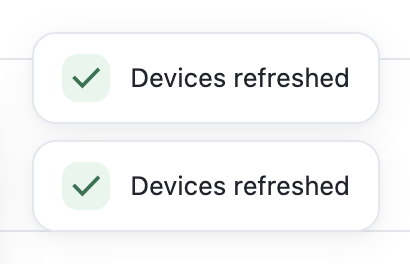
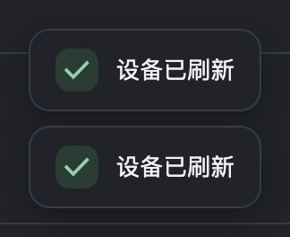

# 主窗口通知样式遗漏

2026-11-04，用户指出“Devices refreshed”提示仍为旧样式。此前 UI 重构记录中的“主窗口反馈使用局部作用域”描述了源码意图，未覆盖这些规则是否进入生产产物；本次明确补上此项验证。

## 原因与处理

`useMainFeedback.ts` 仅副作用导入 `MainFeedback.module.scss`，没有消费 CSS Module 导出。生产 renderer 的 CSS 中未包含主窗口通知规则；真实 Electron 刷新提示使用旧的 4px 圆角、默认状态色与阴影。修复前新验证脚本在圆角断言上按预期失败。

改用 `MainFeedback.scss` 普通样式表，保留 `html[data-workspace-window='true']` 显式范围及主题跟随。通知统一为 12px 圆角、轻阴影、24px 柔和状态底色图标、13px 正文；堆叠间距为 8px，长文案限制宽度并换行，图标与长文案顶部对齐。没有改变提示时长、业务成功/失败判断、消息数量或去重规则。

原有主窗口 Luna 弹窗配色也随样式入口恢复；当前应用详情、端口和确认框使用独立的工作台组件，已有样式保持。未修改投屏、升级窗口或共享通知逻辑。

## 验证与证据

```sh
npm run build:renderer
node script/check-main-feedback.cjs release/main-feedback/final-verified
```

- 真实 Electron 加载生产构建的 renderer/CSS，使用隔离配置和模拟设备；通过实际设备刷新按钮生成两条通知，检查颜色、圆角、尺寸、堆叠及自动消失。
- 中英文 × 深浅色共 4 组通过；各组附加成功/错误/警告/信息和长文案样式样本，验证换行与窗口边界。这些附加样本复制真实通知 DOM，只证明样式，不冒充设备失败业务验收。
- 各组实际打开模拟应用的卸载确认框并取消，确认原有工作台圆角及取消行为正常；没有卸载真实应用。
- 移除主窗口显式作用域后恢复旧 4px 样式，确认规则没有全局污染。未运行实际投屏/升级业务流程，不把作用域测试称为它们的完整回归。
- 初次修复验证在应用行中心点击命中表格列宽调整条，导致测试导航超时；改为点击第一列内容后通过，没有为测试改动业务代码。
- 最终 renderer 构建、lint/i18n 通过；`npm test` 应用 907/907，Licia 生产与 fallback 各 606 passing / 4 pending（已有外部夹具待办）。

构建产物验证数据与哈希见 [JSON](main-feedback-verification.json)，以下为真实渲染截图裁剪（模拟数据）。





## 当前交付范围

源码修改和本机 macOS Electron 验证完成；未提交 PR、未发布新版本、未替换日常安装版。下一步随修复提交执行 CI，并在后续安装包验证通知样式。Windows/macOS x64 原生运行尚未验证。
