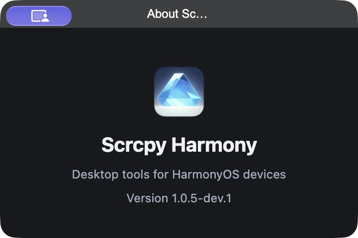

# Scrcpy Harmony 1.0.5-dev.1 开发预发布

状态：**2026-11-03 20:05:46（UTC+8）已公开为 [pre-release](https://github.com/MonsterXia/scrcpy-harmony/releases/tag/v1.0.5-dev.1)，本机已替换并验证**。稳定 Latest 保持 `v1.0.4`，dev.0 与旧版附件保留。[执行计划](../superpowers/plans/2026-11-03-release-1.0.5-dev.1.md)记录用户授权与各阶段状态。

## 来源与正常门禁

- 修复 [PR #83](https://github.com/MonsterXia/scrcpy-harmony/pull/83)：最终头 `a217ad4f902091eec00ea8cd33ce0cb738d18f98` 的[五项 CI](https://github.com/MonsterXia/scrcpy-harmony/actions/runs/41628713123)、Sourcery和独立复核通过，无未解决线程，正常合入 `be973db38ed1ec78ec6e664a8067c40dcf536663`。
- 发行准备 [PR #84](https://github.com/MonsterXia/scrcpy-harmony/pull/84)：最终头 `c4bf7cf697585184e5613eaf51c3288526d44f86` 的[五项 CI](https://github.com/MonsterXia/scrcpy-harmony/actions/runs/41630414498)与 Sourcery 通过；两份 README 的旧版证据链接意见已修复并解决，正常合入 `cd52be6d6505f7557db2503f4ee58162964634bb`。
- tag 与安装包源码固定为 PR84 最终头 `c4bf7cf`，位于 master 历史中。[同源三平台 Build](https://github.com/MonsterXia/scrcpy-harmony/actions/runs/41630447198)均完成真实安装启动；后续证据提交不改变安装包源码。

实际保护要求 test/lint/windows-package/macos-package-arm64/macos-package-x64、严格跟上 master、审查会话已解决，管理员同样受保护；required approval count为0。两次合入均使用 expected head SHA 的正常 API，没有绕过保护。较早候选 `d91443c` 的 CI41629805839 / Build41629807900 因文档修正而取消/废弃，不作为最终发行证据或上传来源。

## 修复与审查

修复商店未收录应用的空响应触发全局冷却，导致后续图标查询被抑制；支持 UITest 复合版本标记，按协议系列选择兼容代理，修复 Mate 80 初始化失败。独立复核发现异族活动 Unix daemon 会进入仅检查 TCP 的恢复路径；补充不可自动恢复的拒绝，有任何 UITest PID 且协议族不兼容时不终止进程、不上传或修改设备参数。

最终本地专项96/96、应用907/907、Licia两模式各606 passing / 4 pending、lint/i18n通过。早期安装补丁的实际图标/Mate 80出图证据分别见[图标记录](../maintenance/app-icon-missing.md)、[Mate 80记录](../maintenance/mate80-screencast-start.md)。并行工具保护通过真实驱动与模拟设备边界测试，不冒充外部工具真机并行验收。

## 发行和升级验证

一次性操作分支固定 `c5768f1d687fe5d29bdc3d67bc024bb680cdb6b0`，不合入产品。发行工具12项离线拒绝/恢复测试及[独立复核](1.0.5-dev.1-operations-review.md)通过；3份ZIP、YAML版本/文件名/size/SHA512、签名与来源检查通过。notes初次缺少完整源SHA，被静态审查发现并在执行前修正；操作分支曾误纳生成pyc，后续提交移除，最终树不含它。

[发布前验收41631209410](https://github.com/MonsterXia/scrcpy-harmony/actions/runs/41631209410)三个原生平台全部通过：各自执行1.0.4→dev.1和dev.0→dev.1，12次已安装应用启动、72场景。六次升级均保留播种的语言/主题/Beta=true，菜单与保存值一致；真实稳定通道选1.0.4、Beta选dev.0，覆盖网络失败/恢复及取消后无迟到窗口。隔离配置的这三项保留不等同全部设置迁移组合。

[草稿上传41631744645](https://github.com/MonsterXia/scrcpy-harmony/actions/runs/41631744645)成功；14项附件全部重新下载逐个校验后才公开，Release ID `432636418`。包含3安装包、3blockmap、3更新YAML、3平台报告、SHA256SUMS和release-validation；[产物来源](1.0.5-dev.1-artifacts.json)、[公开审计](1.0.5-dev.1-audit.json)。

公开后[41632891489](https://github.com/MonsterXia/scrcpy-harmony/actions/runs/41632891489)三个原生平台全部通过，重复两条升级路径、12次已安装应用启动、72场景；稳定选择1.0.4、Beta选择dev.1，dev.1不更新自身/不降级，正确架构元数据与下载页交接通过，六次升级的主题/语言/Beta均保留。公开前后各72场景，本轮未发生验收失败或重跑。[升级摘要](1.0.5-dev.1-update-acceptance.json)。

## 本机替换

从校验过的公开 arm64 DMG 替换 `/Applications/Scrcpy Harmony.app`。原安装为本地修复构建1.0.5-dev.0；正常原生菜单退出后完整备份旧.app与用户配置，93个常规文件逐一核对，app.asar/Info.plist备份一致。暂存包版本、arm64与deep/strict签名通过后替换，安装后再验签名。

实际关于窗口显示1.0.5-dev.1，5个既有设置均保持原值，Beta菜单仍开启。验证时用户当前连接设备已换为nova 15（PSN-AL00，OpenHarmony7.0.0.109/API26）；新包实际出图及关闭重开均通过。Mate 80证据仍属于此前本地补丁，不把nova 15结果写为最终包Mate 80重测。版本截图与[安装证据](1.0.5-dev.1-local-install.json)归档；原应用和配置备份保留本机ignored目录`release/1.0.5-dev.1-local-install/backup-before-install/`，手机画面、设备标识、原始配置不入库。

## 保留边界

Windows未签名；双Mac签名实际为adhoc，details/strict退出码0，Gatekeeper3/stapler65，无Developer ID/公证。本轮不改变系统安全策略。

完整本地离线图标、并行外部UITest工具真机、Windows/macOS x64真机、跨电脑/固件、触控/特定编码和长期运行矩阵未新增验收。此前固定1.0.1/1.0.2历史升级失败保持记录，不将其混同本次明确版本矩阵。发布不自动关闭这些待办。
