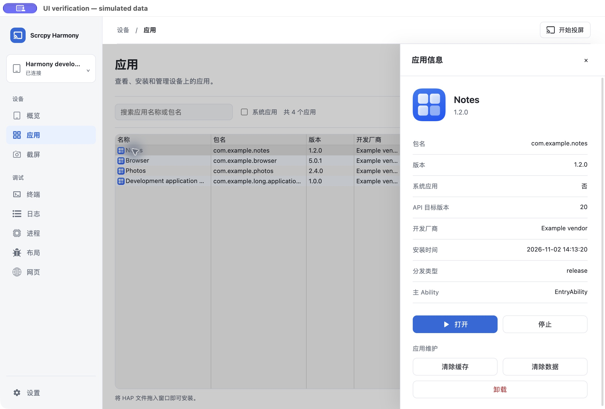
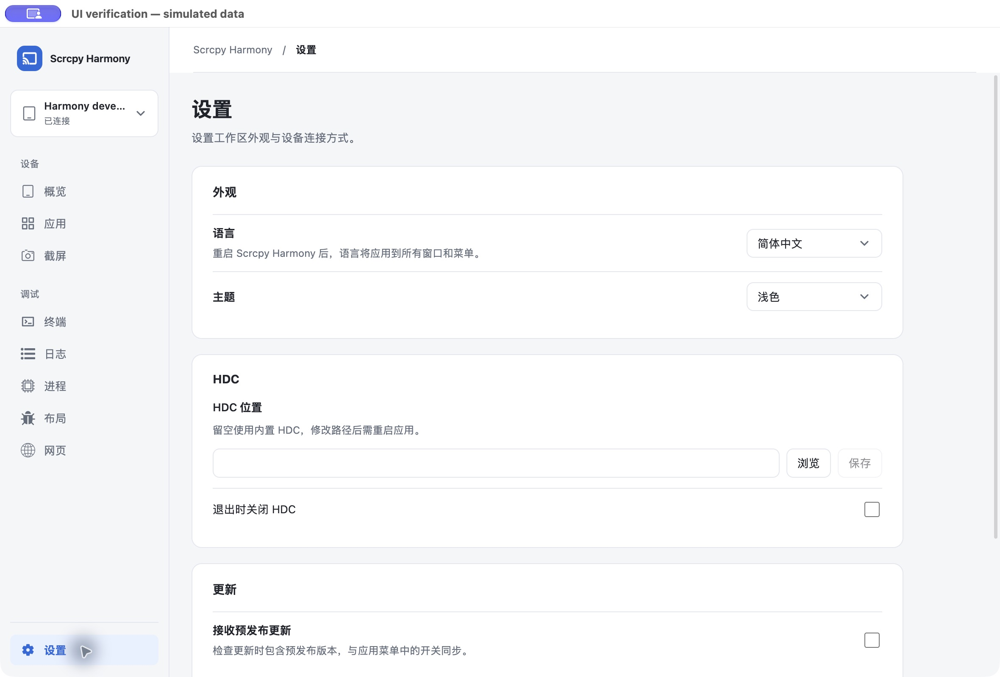

# 1.0.5 工作台使用指南

适用于本分支的 1.0.5 开发候选。公开安装包仍以 [Releases](https://github.com/MonsterXia/scrcpy-harmony/releases) 为准；原 1.0.4 安装、设备授权与投屏说明见[用户指南](user-guide.md)。验证进度和限制见[实施记录](maintenance/v1.0.5-ui-completion.md)。

## 主窗口

左侧按“设备”和“调试”分组：概览、应用、截屏；终端、日志、进程、布局、网页。底部“设置”随时可用，无设备也能修改外观与 HDC 配置。窄窗口侧栏收起为图标，悬停可查看名称。

顶部设备入口用于选择设备和刷新；概览显示连接状态、系统/硬件信息及常用工具。字段旁的复制操作仅在有有效内容时可用。概览中的“开始投屏”以及其他设备页顶部的同名按钮打开原有投屏窗口；投屏和升级窗口延续已有设计。

设备读取失败与正常无设备分开显示，恢复连接后可重试。切换设备会清理旧设备页面状态；同一设备内切换页面会保留已打开页面和终端会话。

## 应用管理

- 搜索同时匹配应用名称和包名；系统应用开关、列表/网格模式和图标大小沿用偏好设置。
- 选中应用可打开右侧详情，查看版本、包名等字段，执行打开、停止、清除缓存/数据、卸载。危险操作先确认，默认焦点在取消。
- 键盘可进入列表、打开详情；Escape 关闭当前确认或详情并返回原控件。
- “安装”选择 HAP，或将 HAP 拖入主窗口。安装刷新和部分应用信息读取失败会有状态反馈。

## 设置与常用工具

设置按外观、HDC、更新、应用分组。主题立即更新当前工作区；语言与 HDC 路径按说明重启后生效，重启由用户主动点击。Beta Update 与原生菜单勾选同步；开启后允许检查预发布版本，不代表自动下载或安装。

概览中的端口映射保留正向/反向及本地/设备端口含义，支持刷新和删除确认。遥控器提供电源、音量、方向、主界面、返回和最近应用按钮。截屏页将重新截图、导出及视图操作分组，支持保存、复制、旋转和缩放；旋转/缩放用于查看，原图导出语义不变。

## 调试页面

进程页按名称搜索，可筛选应用进程；停止前确认当前设备与进程。页面隐藏时停止轮询，返回后刷新。

终端保留多标签会话，关闭最后一个标签后可新建；切换页面后返回原会话。快捷命令先选择再执行，打开命令面板不会自行发送命令。

日志页按级别、包名、标签筛选，提供换行、密度、暂停/恢复、清除、重启与保存。保存包含当前保留的全部记录，包括被筛选隐藏的内容；达到 11,000 条时删除最早 1,000 条，因此不是无限历史备份。“清除”清空当前缓冲区，“重启”会清空设备日志并重新连接。导出前后仍需按时间戳检查所需片段，分享前移除设备标识和私人信息。

以上调试页正在实现和验收，最终状态以实施记录为准。布局、网页和独立工具说明随后补齐。
